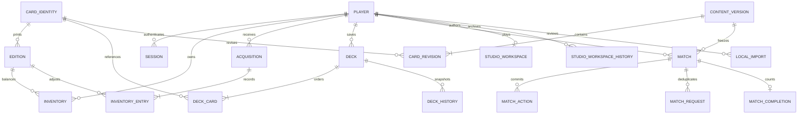

# V1.3D architecture and persistent schema

## Boundaries and technology

React/TypeScript/Vite remain the frontend. `server/` is a separate Fastify TypeScript API, using node-postgres (`pg`) and versioned node-pg-migrate migrations. Fastify keeps HTTP small; Zod validates strict request DTOs, and existing engine/content/transfer validators remain authoritative. `pg` provides parameterized SQL and explicit single-client transactions. node-pg-migrate provides ordered transactional DDL and its own schema ledger. No rules were reimplemented: the backend imports the deterministic engine, computer opponent and replay machinery.

The browser calls same-origin `/api`, never PostgreSQL. DEV uses Vite's loopback proxy; future NGINX proxies to a private backend container. Credentials remain backend-only. Official content comes from reviewed Git definitions/assets; PostgreSQL holds immutable synchronized versions. Browser practice, private drafts and verified account play are separate trust domains.

```text
src/account/        collection, decks, public match view, private Studio adapter
server/auth.ts      PostgreSQL sessions, password verification, roles, CSRF
server/db.ts        connection identity checks and single-client transactions
server/catalog.ts   release synchronization, permanent registry and asset checks
server/inventory.ts starters, acquisitions, quantities, shared deck validation
server/matches.ts   shared-engine authority, backend AI, public projection/replay
server/studio-routes.ts private revisioned workspace and untrusted imports
server/migrations/  ordered, checksummed forward migrations
server/cli.ts       explicit migration/publication/operator/backup/restore
scripts/pg-isolate.mjs separate owned PostgreSQL instance and disposable databases
```

Primary references: [Fastify validation](https://fastify.dev/docs/latest/Reference/Validation-and-Serialization/), [pg queries](https://node-postgres.com/features/queries), [pg transactions](https://node-postgres.com/features/transactions), [node-pg-migrate](https://salsita.github.io/node-pg-migrate/api), [PostgreSQL locking](https://www.postgresql.org/docs/18/explicit-locking.html).

## Relationships



## Schema inventory (`kd`)

| Tables | Purpose and integrity |
| --- | --- |
| `schema_migrations`, `migration_checksum`, `environment_guard` | Migration ordering, SHA256 source ledger, adopted environment/instance boundary. |
| `player`, `session`, `invite`, `rate_bucket` | UUID identity, unique lowercase username, status/role, hashed opaque tokens, expiry/invite uses, atomic throttles. |
| `content_version`, `content_selection` | Unique immutable release/digest/engine/channel and one selected ordinary release. |
| `card_identity`, `card_revision`, `edition` | Permanent number/prefix/serial and Kindred/set/expansion, immutable version definitions, separate printings sharing identity. Retired numbers remain reserved. |
| `inventory`, `acquisition`, `inventory_entry` | Nonnegative player/edition balances, per-player unique idempotency keys/fingerprints, immutable signed ledger and resulting quantities. |
| `deck`, `deck_card`, `deck_history` | Owner, ordered slots, optimistic revision, retained snapshots; soft deletion. Default deck has a composite owner FK. |
| `match`, `match_action`, `match_request`, `match_completion` | Owner, frozen release/config/decks/seed/start/engine, exact state/record, validated actions, request deduplication, one completion marker. |
| `progression_extension` | Reserved structure for later approved systems; no economy/client-writable counters. |
| `studio_workspace`, `studio_workspace_history`, `local_import` | Private full workspace, optimistic revisions, archived snapshots, unique untrusted import fingerprint. |
| `audit_event` | Operator role/status/password changes, grants and private diagnostics without passwords/tokens. |

There are 27 tables including node-pg-migrate's ledger. UUIDs identify players, matches, decks and acquisitions. Permanent card identity is independent of names, statistics, edition and artwork revision. Numbers use case-consistent prefixes and minimum three-digit padding; N1000 is not truncated. Complex abilities/published packs use JSONB rather than excessive relational decomposition. **Exact game states/replay records and private workspaces use PostgreSQL JSON**, preserving object key order required by the existing deterministic replay signature. Relational FKs, uniqueness and checks govern ownership/references.

## Atomic operations and versions

A starter transaction locks the player, checks the one-time marker, resolves the original 30 founding identities against the selected release, grants one copy each, creates its recommended 15-card deck/default/history and marks the choice. Identical retries replay the prior acquisition; another choice rejects. Expansion cards never enlarge the free grant.

Inventory transactions lock the target player, compare a stable payload fingerprint for the per-player key, apply sorted edition changes and append acquisition/ledger atomically. Changed retries reject; missing editions/negative results roll back. Developers grant only themselves; administrators may grant others. Standard/Free Play restrictions use the shared engine and combined ownership across editions. Explicit unrestricted developer testing never earns verified statistics.

Deck edits lock the owner's deck and compare revisions. Every save validates exactly 15 cards, owned quantities, copy/Kindred/ruleset restrictions and retirement status. Alternate editions share copy caps. Owned cards may appear in multiple decks and are not consumed by gameplay.

A server match accepts only human action, expected revision and request ID. It locks the owned match, invokes the shared resolver/backend AI, then commits actions, state, exact record, completion and revision together. Illegal/foreign/stale/duplicate actions reject. Seeds/start player are chosen server-side. Historical release/deck snapshots remain independent of later publication. Statistics query once-per-match verified completion markers; testing/imported play grants none.

Public responses allow only board/public zones, own hand, opponent counts, displayed power layers and score/result. They exclude raw state, opponent hand/draw IDs, seed/RNG, private record, diagnostic steps and deterministic signatures. Public replay reconstructs the shared record server-side then projects every frame. Private diagnostics require developer/admin plus ownership and are audited.

## Migrations and recovery

Four ordered migrations establish foundation, private history, exact match JSON/immutable records and exact private workspace JSON. Checksums use LF sources. They were installed before owner records existed; intermediate JSON conversions require empty affected tables, preventing silent corruption. Execution repeats safely. Never edit applied sources; append a forward migration. Destructive down migration is disabled.

Startup checks readiness without migrating/seeding/resetting. `db:status` checks actual role/database/port, PostgreSQL version, environment guard and source hashes. TEST/PROD CLI commands require explicit environment acknowledgement; neither target was used. Destructive integration operations require both owned manifest and in-database disposable guard, never name/APP_ENV alone.

Backups share one exported repeatable-read snapshot between pg_dump and count queries. Restore creates a fresh database on the separate owned cluster, compares counts/checksums/content, validates exact replays/private workspaces and reconciles the inventory ledger. Pair database history with its Git release/assets; browser-only drafts and uncommitted artwork require separate backup.

## Future multiplayer

The shared engine, serialized match lock/revision, ordered event log, immutable definitions and actor-scoped DTOs provide a foundation. Human matchmaking, seat authorization, reconnect sequencing, transport, timeout policy, competitive RNG protocol, anti-cheat review and load testing remain future work. The internal private record must never become a public multiplayer message format.
