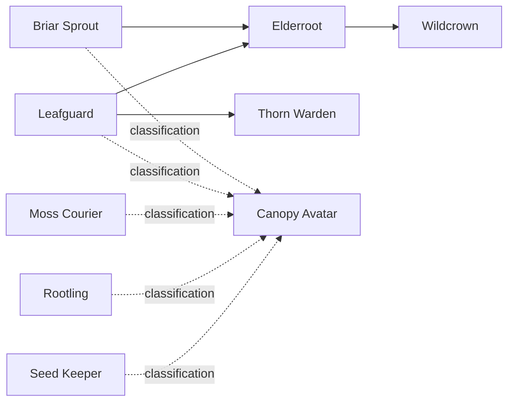
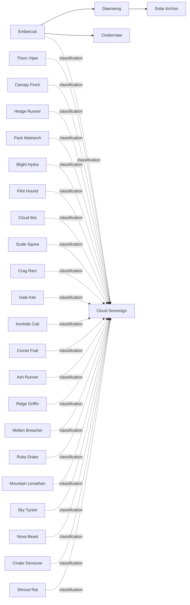
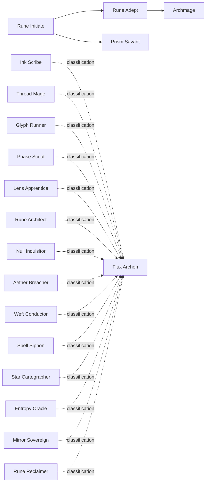
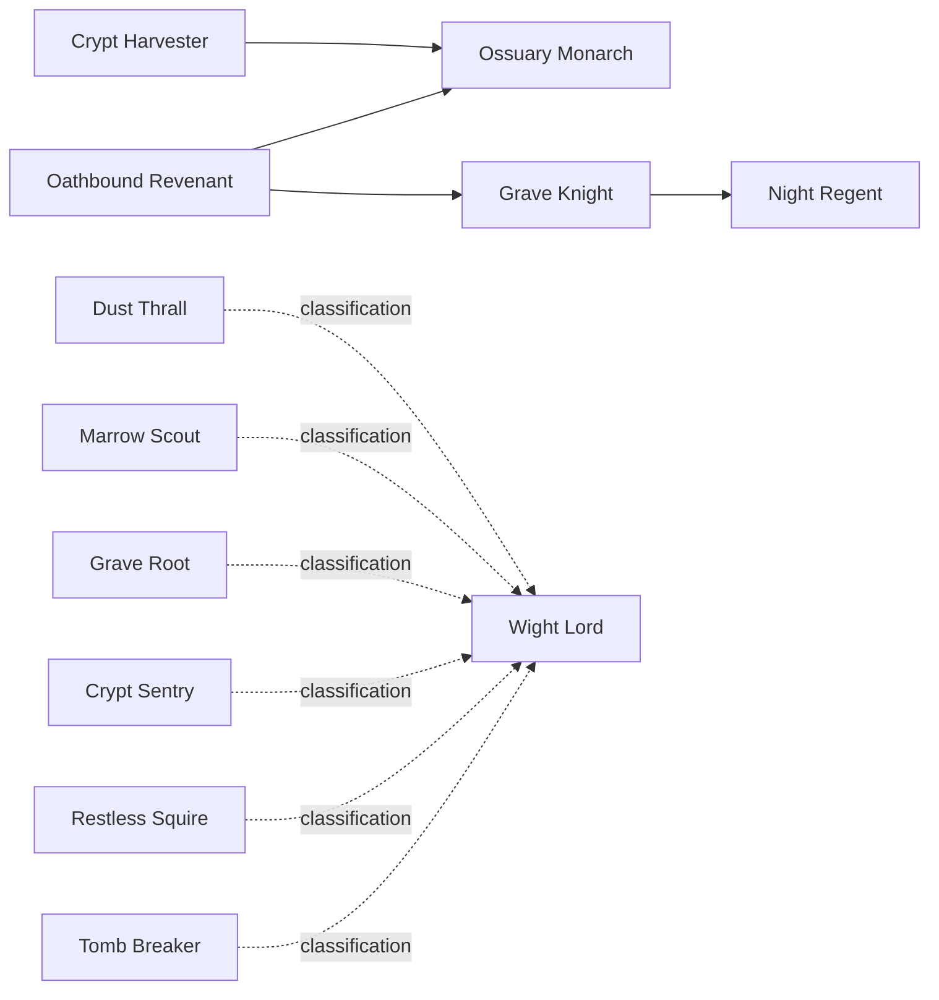
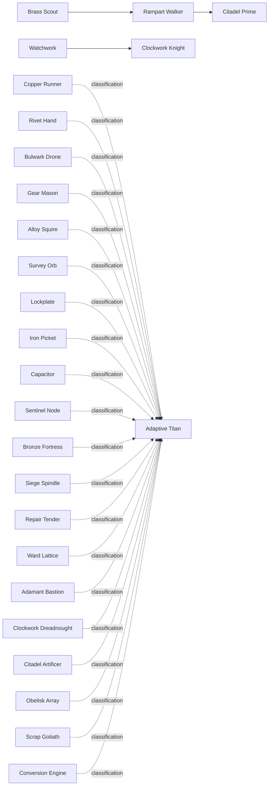

# Founding Kindreds — 150 provisional definitions

Full executable data is in `FOUNDING-CONTENT.json` and the Studio. Each Kindred follows 12 Rank I standards, 7 Rank II standards, 4 Rank III standards, 3 replacements and 4 evolutions; no distribution deviation was needed. Starting decks use 15 different cards and are constructible from one copy of each collection card.

## Nature

Expansion, cooperation and population

| Card | ID | Placement / rank | Power | Executable description |
|---|---|---|---|---|
| Briar Sprout | sprout | standard / 1 | 1 | Expand 1 ahead, above and below. Development copy limit: 3. |
| Leafguard | leafguard | standard / 1 | 3 | Expand 1 ahead. A sturdy opening creature. |
| Grove Tender | grove-tender | standard / 2 | 3 | Expand 1 diagonally ahead. On placement, if you control at least 3 creatures, give all friendly creatures +1 power. Once per lineage per match. |
| Brood Bough | brood-bough | standard / 2 | 2 | Expand 1 diagonally ahead, then summon a Briar Sprout onto each eligible empty friendly target. Once per lineage per match. |
| Elderroot | elderroot | evolution / 2 | 5 | Evolve Briar Sprout or Leafguard. Expand 2 ahead. On evolution, give friendly creatures +1 power; once per lineage per match. |
| Wildcrown | wildcrown | evolution / 3 | 8 | Evolve Elderroot. Expand 2 ahead and diagonally ahead. At the beginning of your turn, draw 1 extra card; once per lineage per match. |
| Moss Courier | moss-courier | standard / 1 | 1 | expansion 1 at 1 forward, 0 down. expansion 1 at 1 forward, -1 down. |
| Rootling | rootling | standard / 1 | 2 | expansion 1 at 0 forward, 0 down. expansion 1 at 1 forward, 0 down. |
| Thistle Scout | thistle-scout | standard / 1 | 2 | expansion 1 at 1 forward, 0 down. expansion 1 at 0 forward, 1 down. |
| Dew Wisp | dew-wisp | standard / 1 | 1 | expansion 1 at 1 forward, -1 down. expansion 1 at 1 forward, 1 down. On placement. Modify fortification +1: Source creature. Limits: 1/event, 1/match. Suppressed for resurrection placement events. |
| Briar Warden | briar-warden | standard / 1 | 2 | expansion 1 at 1 forward, 0 down. fortification 1 at 0 forward, -1 down. |
| Thorn Viper | thorn-viper | standard / 1 | 2 | expansion 1 at 1 forward, 0 down. On placement. Enhance / weaken power -1: enemy Relative position pattern (1 forward, 0 down). Limits: 1/event, 1/match. Suppressed for resurrection placement events. |
| Seed Keeper | seed-keeper | standard / 1 | 1 | expansion 2 at 0 forward, 0 down. expansion 1 at 1 forward, 0 down. On placement. Generate cards in hand +1 [sprout]: your hand. Limits: 1/event, 1/match. Suppressed for resurrection placement events. |
| Canopy Finch | canopy-finch | standard / 1 | 2 | expansion 1 at 1 forward, -1 down. expansion 1 at 1 forward, 1 down. Other creature placement. If the event is friendly. Enhance / weaken power +1: Source creature. Limits: 1/event, 1/turn, 2/match. Suppressed for resurrection placement events. |
| Mycelium Mender | mycelium-mender | standard / 1 | 1 | expansion 1 at 1 forward, 0 down. expansion 1 at 0 forward, 1 down. End of your turn. Enhance / weaken power +1: friendly Relative position pattern (0 forward, 0 down; 0 forward, -1 down). Limits: 1/event, 1/turn, 2/match. Suppressed for resurrection placement events. |
| Hedge Runner | hedge-runner | standard / 1 | 3 | expansion 1 at 2 forward, 0 down. |
| Vine Engineer | vine-engineer | standard / 2 | 3 | expansion 1 at 0 forward, 0 down. expansion 2 at 1 forward, 0 down. fortification 1 at 0 forward, 1 down. On placement. Modify placement tokens +1: friendly All eligible positions / creatures. Limits: 1/event, 1/match. Suppressed for resurrection placement events. |
| Venom Orchid | venom-orchid | standard / 2 | 3 | expansion 1 at 1 forward, 0 down. expansion 1 at 1 forward, -1 down. On placement. Enhance / weaken power -1: enemy Relative position pattern (1 forward, -1 down; 1 forward, 0 down; 1 forward, 1 down). Limits: 1/event, 1/match. Suppressed for resurrection placement events. |
| Pack Matriarch | pack-matriarch | standard / 2 | 3 | expansion 1 at 1 forward, 0 down. expansion 1 at 0 forward, 1 down. On placement. If you control at least 3 creatures. Enhance / weaken power +1: friendly All eligible positions / creatures classified beast, excluding the source. Limits: 1/event, 1/match. Suppressed for resurrection placement events. |
| Grove Bastion | grove-bastion | standard / 2 | 4 | expansion 1 at 1 forward, 0 down. fortification 2 at 0 forward, 0 down. fortification 1 at 0 forward, -1 down. |
| Bramble Invader | bramble-invader | standard / 2 | 3 | overthrow 1 at 1 forward, 0 down. expansion 1 at 1 forward, 1 down. |
| Verdant Colossus | verdant-colossus | standard / 3 | 7 | expansion 2 at 1 forward, 0 down. expansion 1 at 2 forward, 0 down. fortification 1 at 0 forward, 0 down. |
| Swarm Sovereign | swarm-sovereign | standard / 3 | 5 | expansion 2 at 1 forward, -1 down. expansion 2 at 1 forward, 1 down. On placement. Summon a standard creature [sprout]: friendly Relative position pattern (1 forward, -1 down; 1 forward, 1 down). Limits: 1/event, 1/match. Suppressed for resurrection placement events. |
| Worldtree Heart | worldtree-heart | standard / 3 | 6 | expansion 2 at 1 forward, 0 down. fortification 2 at 0 forward, 0 down. Beginning of your turn. If you control at least 3 creatures. Enhance / weaken power +1: friendly All eligible positions / creatures. Limits: 1/event, 1/turn, 2/match. Suppressed for resurrection placement events. |
| Blight Hydra | blight-hydra | standard / 3 | 6 | expansion 1 at 1 forward, 0 down. overthrow 1 at 1 forward, -1 down. On placement. Enhance / weaken power -1: enemy All eligible positions / creatures. Limits: 1/event, 1/match. Suppressed for resurrection placement events. |
| Compost Behemoth | compost-behemoth | replacement / 2 | 5 | expansion 2 at 1 forward, 0 down. On replacement. Enhance / weaken power +1: friendly All eligible positions / creatures. Limits: 1/event, 1/match. Suppressed for resurrection placement events. |
| Thorn Harvester | thorn-harvester | replacement / 2 | 4 | expansion 1 at 1 forward, 0 down. expansion 1 at 1 forward, -1 down. Requires classification seedling or classification plant. On replacement. Direct destruction: enemy Relative position pattern (1 forward, 0 down). Limits: 1/event, 1/match. Suppressed for resurrection placement events. |
| Spore Regent | spore-regent | replacement / 2 | 4 | expansion 1 at 1 forward, 0 down. expansion 1 at 0 forward, 1 down. On replacement. Generate cards in hand +1 [leafguard]: your hand. Then Modify fortification +1: friendly All eligible positions / creatures. Limits: 1/event, 1/match. Suppressed for resurrection placement events. |
| Thorn Warden | thorn-warden | evolution / 2 | 4 | expansion 2 at 1 forward, 0 down. fortification 1 at 0 forward, 0 down. Requires leafguard. On evolution. Enhance / weaken power -1: enemy Relative position pattern (1 forward, 0 down). Limits: 1/event, 1/match. Suppressed for resurrection placement events. |
| Canopy Avatar | canopy-avatar | evolution / 2 | 5 | expansion 2 at 1 forward, -1 down. expansion 2 at 1 forward, 1 down. Requires classification seedling, at least 1 power. On evolution. If you control at least 2 creatures. Enhance / weaken power +1: friendly All eligible positions / creatures. Limits: 1/event, 1/match. Suppressed for resurrection placement events. |

## Mythical

Power, destruction and resilience

| Card | ID | Placement / rank | Power | Executable description |
|---|---|---|---|---|
| Embercub | embercub | standard / 1 | 3 | Expand 1 ahead. Can evolve into Dawnwing. Development copy limit: 3. |
| Dawnwing | dawnwing | evolution / 2 | 5 | Evolve Embercub. Expand 2 ahead and 1 above. On evolution, give friendly creatures +1 power; once per lineage per match. |
| Stormwyrm | stormwyrm | standard / 3 | 8 | Expand 2 ahead. On placement, weaken all enemy creatures by 2 simultaneously. Once per lineage per match. |
| Ashen Phoenix | ashen-phoenix | standard / 2 | 4 | Expand 1 ahead and below. On destruction, resurrect on the first eligible friendly empty position. Once per lineage per match; power modifiers persist. |
| Rift Titan | rift-titan | replacement / 3 | 7 | Replace a friendly creature with at least 2 current power. Expand 2 ahead. On replacement, directly destroy the enemy creature ahead. |
| Sunlance | sunlance | standard / 2 | 4 | Expand 1 ahead. On placement, directly destroy the enemy creature two positions ahead. Once per lineage per match. |
| Flint Hound | flint-hound | standard / 1 | 2 | expansion 1 at 1 forward, 0 down. expansion 1 at 0 forward, -1 down. |
| Cloud Ibis | cloud-ibis | standard / 1 | 2 | expansion 1 at 1 forward, -1 down. expansion 1 at 0 forward, 1 down. |
| Scale Squire | scale-squire | standard / 1 | 1 | expansion 1 at 1 forward, 0 down. fortification 2 at 0 forward, 0 down. |
| Sun Spark | sun-spark | standard / 1 | 1 | expansion 2 at 0 forward, 0 down. expansion 1 at 1 forward, 0 down. On placement. If you control at least 2 creatures. Enhance / weaken power +1: Source creature. Limits: 1/event, 1/match. Suppressed for resurrection placement events. |
| Crag Ram | crag-ram | standard / 1 | 2 | expansion 2 at 1 forward, 0 down. |
| Gale Kite | gale-kite | standard / 1 | 1 | expansion 1 at 2 forward, 0 down. expansion 1 at 1 forward, -1 down. On placement. Draw cards +1: your hand. Limits: 1/event, 1/match. Suppressed for resurrection placement events. |
| Cinder Monk | cinder-monk | standard / 1 | 2 | expansion 1 at 0 forward, 0 down. expansion 1 at 1 forward, 0 down. Beginning of your turn. Enhance / weaken power +1: Source creature. Limits: 1/event, 1/match. Suppressed for resurrection placement events. |
| Ironhide Cub | ironhide-cub | standard / 1 | 2 | expansion 1 at 1 forward, 0 down. |
| Comet Foal | comet-foal | standard / 1 | 1 | expansion 1 at 1 forward, -1 down. expansion 1 at 1 forward, 1 down. expansion 1 at 0 forward, 0 down. |
| Ash Runner | ash-runner | standard / 1 | 2 | expansion 1 at 1 forward, 0 down. expansion 1 at 0 forward, 1 down. On destruction. Enhance / weaken power -1: enemy Relative position pattern (1 forward, 0 down). Limits: 1/event, 1/match. Suppressed for resurrection placement events. |
| Dawn Herald | dawn-herald | standard / 1 | 2 | expansion 1 at 1 forward, 0 down. On placement. If you control at least 3 creatures. Enhance / weaken power +1: friendly Relative position pattern (0 forward, -1 down; 0 forward, 1 down). Limits: 1/event, 1/match. Suppressed for resurrection placement events. |
| Ridge Griffin | ridge-griffin | standard / 2 | 4 | expansion 2 at 1 forward, 0 down. expansion 1 at 0 forward, -1 down. |
| Molten Breacher | molten-breacher | standard / 2 | 4 | overthrow 1 at 1 forward, 0 down. expansion 1 at 1 forward, 1 down. |
| Thunder Priest | thunder-priest | standard / 2 | 4 | expansion 1 at 1 forward, 0 down. On placement. If you control at least 3 creatures. Direct destruction: enemy Relative position pattern (1 forward, 0 down). Limits: 1/event, 1/match. Suppressed for resurrection placement events. |
| Ruby Drake | ruby-drake | standard / 2 | 5 | expansion 1 at 1 forward, 0 down. fortification 1 at 0 forward, 0 down. |
| Ember Choir | ember-choir | standard / 2 | 3 | expansion 1 at 1 forward, -1 down. expansion 1 at 1 forward, 1 down. On placement. If you control at least 2 creatures. Enhance / weaken power +1: friendly All eligible positions / creatures classified beast. Limits: 1/event, 1/match. Suppressed for resurrection placement events. |
| Mountain Leviathan | mountain-leviathan | standard / 3 | 9 | expansion 1 at 1 forward, 0 down. fortification 2 at 0 forward, 0 down. |
| Sky Tyrant | sky-tyrant | standard / 3 | 7 | expansion 2 at 1 forward, -1 down. expansion 2 at 1 forward, 1 down. On placement. Direct destruction: enemy Relative position pattern (1 forward, 0 down). Limits: 1/event, 1/match. Suppressed for resurrection placement events. |
| Nova Beast | nova-beast | standard / 3 | 6 | expansion 2 at 1 forward, 0 down. overthrow 1 at 1 forward, -1 down. On placement. Enhance / weaken power -1: All eligible positions / creatures. Limits: 1/event, 1/match. Suppressed for resurrection placement events. |
| Cinder Devourer | cinder-devourer | replacement / 3 | 6 | expansion 2 at 1 forward, 0 down. Requires classification beast. On replacement. If you control at least 3 creatures. Enhance / weaken power +2: Source creature. Limits: 1/event, 1/match. Suppressed for resurrection placement events. |
| Immortal Sentinel | immortal-sentinel | replacement / 2 | 5 | expansion 1 at 1 forward, 0 down. fortification 2 at 0 forward, 0 down. On replacement. Draw cards +1: your hand. Limits: 1/event, 1/match. Suppressed for resurrection placement events. |
| Cindermaw | cindermaw | evolution / 2 | 5 | expansion 2 at 1 forward, 0 down. overthrow 1 at 1 forward, -1 down. Requires embercub. On evolution. Enhance / weaken power +1: Source creature. Limits: 1/event, 1/match. Suppressed for resurrection placement events. |
| Solar Archon | solar-archon | evolution / 3 | 8 | expansion 2 at 1 forward, -1 down. expansion 2 at 1 forward, 1 down. Requires dawnwing. On evolution. Direct destruction: enemy Relative position pattern (1 forward, 0 down). Limits: 1/event, 1/match. Suppressed for resurrection placement events. |
| Cloud Sovereign | cloud-sovereign | evolution / 3 | 6 | expansion 1 at 1 forward, 0 down. expansion 1 at 2 forward, 0 down. Requires classification beast, at least 2 power. On evolution. Grant protection (Immune to weakening): Source creature. Limits: 1/event, 1/match. Suppressed for resurrection placement events. |

## Arcane

Manipulation, transformation and disruption

| Card | ID | Placement / rank | Power | Executable description |
|---|---|---|---|---|
| Rune Initiate | rune-initiate | standard / 1 | 2 | Reinforce this position by 1 and expand 1 ahead. On placement, generate a Rune Initiate in hand; once per lineage per match. Development copy limit: 3. |
| Mirror Adept | mirror-adept | standard / 1 | 1 | Expand 1 diagonally ahead. On placement, draw 1 card. Once per lineage per match. |
| Hex Weaver | hex-weaver | standard / 2 | 3 | Expand 1 ahead. On placement, weaken enemy creatures ahead and diagonally ahead by 2 simultaneously; once per lineage per match. |
| Transmuter | transmuter | replacement / 2 | 4 | Replace any friendly creature. Expand 1 ahead. On replacement, return the enemy creature ahead (and its previous stages) to its owner’s hand, without death triggers. |
| Void Seer | void-seer | standard / 3 | 5 | Expand 2 ahead. On placement, banish the enemy creature two positions ahead, including its evolution stack. No death triggers. Once per lineage per match. |
| Convergence | convergence | standard / 2 | 2 | Expand 2 ahead. On placement, weaken ALL creatures, including this one, by 2 simultaneously. Remove every defeated creature before death abilities resolve. |
| Ink Scribe | ink-scribe | standard / 1 | 1 | expansion 1 at 0 forward, 0 down. expansion 1 at 1 forward, 0 down. On placement. Draw cards +1: your hand. Limits: 1/event, 1/match. Suppressed for resurrection placement events. |
| Prism Mote | prism-mote | standard / 1 | 1 | expansion 1 at 1 forward, -1 down. expansion 1 at 1 forward, 1 down. expansion 1 at 0 forward, 1 down. |
| Glass Ward | glass-ward | standard / 1 | 2 | expansion 1 at 1 forward, -1 down. fortification 1 at 0 forward, 0 down. |
| Thread Mage | thread-mage | standard / 1 | 2 | expansion 1 at 0 forward, 0 down. expansion 1 at 1 forward, 0 down. Other creature placement. If the event is friendly. Enhance / weaken power +1: Source creature. Limits: 1/event, 1/turn, 1/match. Suppressed for resurrection placement events. |
| Glyph Runner | glyph-runner | standard / 1 | 3 | expansion 1 at 1 forward, -1 down. |
| Mist Familiar | mist-familiar | standard / 1 | 1 | expansion 1 at 1 forward, 0 down. On destruction. Draw cards +1: your hand. Limits: 1/event, 1/match. Suppressed for resurrection placement events. |
| Phase Scout | phase-scout | standard / 1 | 2 | expansion 1 at 2 forward, 0 down. expansion 1 at 0 forward, -1 down. |
| Lens Apprentice | lens-apprentice | standard / 1 | 1 | expansion 1 at 1 forward, 0 down. fortification 1 at 0 forward, -1 down. On placement. Enhance / weaken power +1: friendly Relative position pattern (0 forward, -1 down). Limits: 1/event, 1/match. Suppressed for resurrection placement events. |
| Quill Swarm | quill-swarm | standard / 1 | 1 | expansion 1 at 1 forward, 1 down. expansion 2 at 0 forward, 0 down. On placement. Generate cards in hand +1 [mirror-adept]: your hand. Limits: 1/event, 1/match. Suppressed for resurrection placement events. |
| Rune Architect | rune-architect | standard / 1 | 1 | expansion 2 at 1 forward, 0 down. expansion 1 at 0 forward, 0 down. |
| Null Inquisitor | null-inquisitor | standard / 2 | 4 | expansion 1 at 1 forward, 0 down. On placement. Return to hand: enemy Relative position pattern (1 forward, 0 down). Limits: 1/event, 1/match. Suppressed for resurrection placement events. |
| Prism Bulwark | prism-bulwark | standard / 2 | 3 | expansion 1 at 1 forward, 0 down. fortification 2 at 0 forward, 0 down. On placement. Grant protection (Immune to weakening): friendly Relative position pattern (0 forward, -1 down; 0 forward, 1 down). Limits: 1/event, 1/match. Suppressed for resurrection placement events. |
| Aether Breacher | aether-breacher | standard / 2 | 3 | overthrow 2 at 1 forward, 0 down. expansion 1 at 0 forward, 1 down. On placement. Modify placement tokens +1: Source creature. Limits: 1/event, 1/match. Suppressed for resurrection placement events. |
| Weft Conductor | weft-conductor | standard / 2 | 3 | expansion 1 at 1 forward, -1 down. expansion 1 at 1 forward, 1 down. Other creature placement. If the event is friendly. Modify placement tokens +1: Source creature. Limits: 1/event, 1/turn, 2/match. Suppressed for resurrection placement events. |
| Spell Siphon | spell-siphon | standard / 2 | 4 | expansion 1 at 1 forward, 0 down. expansion 1 at 0 forward, 0 down. On placement. Enhance / weaken power -2: enemy Relative position pattern (1 forward, 0 down). Then Enhance / weaken power +1: Source creature. Limits: 1/event, 1/match. Suppressed for resurrection placement events. |
| Star Cartographer | star-cartographer | standard / 3 | 6 | expansion 2 at 1 forward, -1 down. expansion 2 at 1 forward, 1 down. expansion 1 at 2 forward, 0 down. On placement. Modify placement tokens +1: friendly All eligible positions / creatures. Limits: 1/event, 1/match. Suppressed for resurrection placement events. |
| Entropy Oracle | entropy-oracle | standard / 3 | 5 | expansion 2 at 1 forward, 0 down. fortification 1 at 0 forward, 0 down. On placement. Enhance / weaken power -2: enemy All eligible positions / creatures. Then Draw cards +1: your hand. Limits: 1/event, 1/match. Suppressed for resurrection placement events. |
| Mirror Sovereign | mirror-sovereign | standard / 3 | 6 | expansion 2 at 1 forward, 0 down. On placement. Banish to exile: enemy Relative position pattern (1 forward, 0 down). Limits: 1/event, 1/match. Suppressed for resurrection placement events. |
| Rune Reclaimer | rune-reclaimer | replacement / 2 | 4 | expansion 1 at 1 forward, 0 down. expansion 1 at 0 forward, 0 down. On replacement. Draw cards +2: your hand. Limits: 1/event, 1/match. Suppressed for resurrection placement events. |
| Paradox Shell | paradox-shell | replacement / 2 | 5 | expansion 1 at 1 forward, -1 down. expansion 1 at 1 forward, 1 down. fortification 1 at 0 forward, 0 down. On replacement. Return to hand: friendly Relative position pattern (0 forward, -1 down), excluding the source. Limits: 1/event, 1/match. Suppressed for resurrection placement events. |
| Rune Adept | rune-adept | evolution / 2 | 4 | expansion 2 at 1 forward, 0 down. Requires rune-initiate. On evolution. Draw cards +1: your hand. Limits: 1/event, 1/match. Suppressed for resurrection placement events. |
| Prism Savant | prism-savant | evolution / 2 | 3 | expansion 2 at 1 forward, -1 down. expansion 2 at 1 forward, 1 down. Requires rune-initiate. On evolution. Grant protection (Immune to weakening): friendly All eligible positions / creatures. Limits: 1/event, 1/match. Suppressed for resurrection placement events. |
| Archmage | archmage | evolution / 3 | 7 | expansion 2 at 1 forward, 0 down. overthrow 1 at 1 forward, -1 down. Requires rune-adept. On evolution. Enhance / weaken power -1: enemy All eligible positions / creatures. Limits: 1/event, 1/match. Suppressed for resurrection placement events. |
| Flux Archon | flux-archon | evolution / 2 | 5 | expansion 1 at 1 forward, 0 down. expansion 1 at 2 forward, 0 down. Requires classification mage, at least 2 power. On evolution. Return to hand: enemy Relative position pattern (1 forward, 0 down). Limits: 1/event, 1/match. Suppressed for resurrection placement events. |

## Undead

Sacrifice, resurrection and death

| Card | ID | Placement / rank | Power | Executable description |
|---|---|---|---|---|
| Bone Thrall | bone-thrall | standard / 1 | 2 | Expand 1 ahead. On sacrifice, give all surviving friendly creatures +1 power, including its replacement. Once per lineage per match. Development copy limit: 3. |
| Grave Acolyte | grave-acolyte | standard / 1 | 1 | Expand 1 ahead and above. When another friendly creature is destroyed or sacrificed, gain +1 power. At most twice per turn and six times per lineage per match. |
| Crypt Harvester | crypt-harvester | replacement / 2 | 4 | Replace any friendly creature. Expand 1 ahead and below. On replacement, draw 1 card; once per lineage per match. |
| Oathbound Revenant | revenant | standard / 2 | 4 | Expand 2 ahead. On destruction, resurrect on the first eligible friendly empty position. Once per lineage per match; power modifiers persist. |
| Death Shepherd | death-shepherd | standard / 3 | 5 | Expand 1 ahead. On placement, resurrect the first eligible friendly graveyard card. Each lineage may be recalled once by this effect. Evolution requires a matching predecessor. |
| Ossuary Monarch | ossuary-monarch | evolution / 3 | 7 | Evolve Crypt Harvester or Oathbound Revenant. Expand 2 diagonally ahead. On destruction, weaken all enemies by 2 simultaneously; once per lineage per match. |
| Dust Thrall | dust-thrall | standard / 1 | 1 | expansion 1 at 1 forward, 0 down. expansion 1 at 0 forward, 0 down. On destruction. Enhance / weaken power +1: friendly Relative position pattern (0 forward, -1 down; 0 forward, 1 down). Limits: 1/event, 1/match. Suppressed for resurrection placement events. |
| Marrow Scout | marrow-scout | standard / 1 | 2 | expansion 1 at 1 forward, 0 down. expansion 1 at 0 forward, 1 down. |
| Tomb Moth | tomb-moth | standard / 1 | 1 | expansion 1 at 1 forward, -1 down. expansion 1 at 1 forward, 1 down. On destruction. Draw cards +1: your hand. Limits: 1/event, 1/match. Suppressed for resurrection placement events. |
| Lantern Wight | lantern-wight | standard / 1 | 1 | expansion 1 at 1 forward, 0 down. expansion 1 at 0 forward, 0 down. fortification 1 at 0 forward, -1 down. |
| Pale Disciple | pale-disciple | standard / 1 | 2 | expansion 1 at 1 forward, 0 down. On sacrifice. Modify placement tokens +1: friendly All eligible positions / creatures. Limits: 1/event, 1/match. Suppressed for resurrection placement events. |
| Grave Root | grave-root | standard / 1 | 1 | expansion 2 at 1 forward, 0 down. On destruction. Modify fortification +1: friendly All eligible positions / creatures. Limits: 1/event, 1/match. Suppressed for resurrection placement events. |
| Shroud Rat | shroud-rat | standard / 1 | 2 | expansion 1 at 1 forward, -1 down. expansion 1 at 0 forward, 1 down. On placement. Enhance / weaken power -1: enemy Relative position pattern (1 forward, 0 down). Limits: 1/event, 1/match. Suppressed for resurrection placement events. |
| Crypt Sentry | crypt-sentry | standard / 1 | 3 | expansion 1 at 0 forward, 0 down. expansion 1 at 1 forward, -1 down. |
| Bone Chorister | bone-chorister | standard / 1 | 1 | expansion 1 at 1 forward, 0 down. expansion 1 at 0 forward, -1 down. Other creature destruction. If the event is friendly. Draw cards +1: your hand. Limits: 1/event, 1/turn, 2/match. Suppressed for resurrection placement events. |
| Restless Squire | restless-squire | standard / 1 | 2 | expansion 1 at 1 forward, 0 down. On destruction. Resurrect the source, at most 1 time(s) per instance and lineage. Persistent modifiers and universal limits apply. Limits: 1/event, 1/match. Suppressed for resurrection placement events. |
| Soul Binder | soul-binder | standard / 2 | 3 | expansion 1 at 1 forward, 0 down. expansion 1 at 0 forward, 0 down. On destruction. Enhance / weaken power -1: enemy All eligible positions / creatures. Limits: 1/event, 1/match. Suppressed for resurrection placement events. |
| Barrow Guard | barrow-guard | standard / 2 | 4 | expansion 1 at 1 forward, 0 down. fortification 2 at 0 forward, 0 down. |
| Grave Marshal | grave-marshal | standard / 2 | 4 | expansion 2 at 1 forward, 0 down. On placement. Enhance / weaken power +1: friendly All eligible positions / creatures classified thrall. Limits: 1/event, 1/match. Suppressed for resurrection placement events. |
| Plague Bearer | plague-bearer | standard / 2 | 3 | expansion 1 at 1 forward, 0 down. expansion 1 at 0 forward, 1 down. On placement. Enhance / weaken power -1: enemy Relative position pattern (1 forward, -1 down; 1 forward, 0 down; 1 forward, 1 down). Limits: 1/event, 1/match. Suppressed for resurrection placement events. |
| Tomb Breaker | tomb-breaker | standard / 2 | 3 | overthrow 2 at 1 forward, 0 down. expansion 1 at 1 forward, -1 down. |
| Spirit Caller | spirit-caller | standard / 2 | 2 | expansion 1 at 1 forward, -1 down. expansion 1 at 1 forward, 1 down. On placement. Resurrect the first eligible friendly graveyard card, at most 1 time(s) per instance and lineage. Persistent modifiers and universal limits apply. Limits: 1/event, 1/match. Suppressed for resurrection placement events. |
| Necropolis Heart | necropolis-heart | standard / 3 | 6 | expansion 2 at 1 forward, 0 down. fortification 2 at 0 forward, 0 down. End of your turn. Generate cards in hand +1 [bone-thrall]: your hand. Limits: 1/event, 1/turn, 2/match. Suppressed for resurrection placement events. |
| Dread Procession | dread-procession | standard / 3 | 7 | expansion 1 at 1 forward, 0 down. expansion 2 at 0 forward, -1 down. expansion 2 at 0 forward, 1 down. On placement. Enhance / weaken power -2: enemy Relative position pattern (1 forward, 0 down). Limits: 1/event, 1/match. Suppressed for resurrection placement events. |
| Last Bell | last-bell | standard / 3 | 5 | expansion 2 at 1 forward, 0 down. On placement. Direct destruction: friendly All eligible positions / creatures classified thrall, excluding the source. Then Resurrect the first eligible friendly graveyard card, at most 1 time(s) per instance and lineage. Persistent modifiers and universal limits apply. Limits: 1/event, 1/match. Suppressed for resurrection placement events. |
| Marrow Abomination | marrow-abomination | replacement / 3 | 6 | expansion 2 at 1 forward, 0 down. Requires classification undead. On replacement. Enhance / weaken power +1: Source creature. Limits: 1/event, 1/match. Suppressed for resurrection placement events. On destruction. Enhance / weaken power -2: enemy Relative position pattern (1 forward, 0 down). Limits: 1/event, 1/match. Suppressed for resurrection placement events. |
| Soul Vessel | soul-vessel | replacement / 2 | 4 | expansion 1 at 1 forward, 0 down. fortification 1 at 0 forward, 0 down. On replacement. Resurrect the first eligible friendly graveyard card, at most 1 time(s) per instance and lineage. Persistent modifiers and universal limits apply. Limits: 1/event, 1/match. Suppressed for resurrection placement events. |
| Grave Knight | grave-knight | evolution / 2 | 5 | expansion 2 at 1 forward, 0 down. fortification 2 at 0 forward, 0 down. Requires revenant. On evolution. Modify placement tokens +1: friendly All eligible positions / creatures. Limits: 1/event, 1/match. Suppressed for resurrection placement events. |
| Night Regent | night-regent | evolution / 3 | 8 | expansion 2 at 1 forward, -1 down. expansion 2 at 1 forward, 1 down. Requires grave-knight. On destruction. Enhance / weaken power -1: enemy All eligible positions / creatures. Then Resurrect the first eligible friendly graveyard card, at most 1 time(s) per instance and lineage. Persistent modifiers and universal limits apply. Limits: 1/event, 1/match. Suppressed for resurrection placement events. |
| Wight Lord | wight-lord | evolution / 2 | 5 | expansion 1 at 1 forward, 0 down. expansion 1 at 0 forward, 0 down. Requires classification thrall, at least 1 power. On evolution. Enhance / weaken power +1: friendly All eligible positions / creatures classified thrall. Limits: 1/event, 1/match. Suppressed for resurrection placement events. |

## Constructs

Fortification, protection and defense

| Card | ID | Placement / rank | Power | Executable description |
|---|---|---|---|---|
| Brass Scout | brass-scout | standard / 1 | 2 | Expand 1 ahead. Fortify this position by 1. Development copy limit: 3. |
| Walking Bastion | bastion | standard / 2 | 4 | Expand 1 ahead. Fortify this position and friendly positions above and below by 2. |
| Siege Walker | siege-walker | standard / 2 | 3 | Overthrow unoccupied enemy territory ahead, clearing fortification and establishing 2 tokens. Expand 1 above. Overthrow does not claim neutral territory. |
| Aegis Core | aegis-core | standard / 2 | 3 | Expand 1 ahead and fortify here by 1. Immune to direct destruction, but can be sacrificed. On placement, give current friendly creatures protection from weakening; once per lineage per match. |
| Iron Colossus | iron-colossus | replacement / 3 | 7 | Replace a friendly Construct. Expand 2 ahead. Fortify friendly positions above and below by 3, then fortify this position by 2. |
| Watchwork | watchwork | standard / 1 | 1 | Expand 1 ahead. At your turn start gain +1 power, up to 3 times per lineage per match. At your turn end reinforce this and the friendly position ahead by 1 token. |
| Copper Runner | copper-runner | standard / 1 | 1 | expansion 1 at 1 forward, 0 down. expansion 1 at 0 forward, -1 down. fortification 1 at 0 forward, 0 down. |
| Rivet Hand | rivet-hand | standard / 1 | 1 | expansion 2 at 0 forward, 0 down. expansion 1 at 1 forward, 0 down. On placement. Modify fortification +1: friendly Relative position pattern (0 forward, -1 down; 0 forward, 1 down). Limits: 1/event, 1/match. Suppressed for resurrection placement events. |
| Bulwark Drone | bulwark-drone | standard / 1 | 2 | expansion 1 at 1 forward, -1 down. fortification 1 at 0 forward, 0 down. fortification 1 at 0 forward, 1 down. |
| Gear Mason | gear-mason | standard / 1 | 1 | expansion 1 at 1 forward, 0 down. expansion 1 at 0 forward, 0 down. fortification 1 at 0 forward, 1 down. |
| Alloy Squire | alloy-squire | standard / 1 | 3 | expansion 1 at 1 forward, -1 down. fortification 1 at 0 forward, 0 down. |
| Survey Orb | survey-orb | standard / 1 | 1 | expansion 2 at 1 forward, -1 down. expansion 2 at 1 forward, 1 down. expansion 1 at 0 forward, 0 down. |
| Lockplate | lockplate | standard / 1 | 2 | expansion 1 at 0 forward, 0 down. fortification 2 at 0 forward, 0 down. expansion 1 at 0 forward, -1 down. |
| Iron Picket | iron-picket | standard / 1 | 1 | expansion 1 at 1 forward, 0 down. overthrow 1 at 1 forward, -1 down. |
| Capacitor | capacitor | standard / 1 | 1 | expansion 1 at 1 forward, 0 down. Beginning of your turn. Modify placement tokens +1: friendly All eligible positions / creatures. Limits: 1/event, 1/turn, 2/match. Suppressed for resurrection placement events. |
| Sentinel Node | sentinel-node | standard / 1 | 2 | expansion 1 at 1 forward, 0 down. expansion 1 at 0 forward, 1 down. fortification 1 at 0 forward, -1 down. Other creature placement. If the event is friendly. Grant protection (Immune to weakening): friendly Triggering creature. Limits: 1/event, 1/turn, 2/match. Suppressed for resurrection placement events. |
| Bronze Fortress | bronze-fortress | standard / 2 | 4 | expansion 1 at 1 forward, 0 down. fortification 3 at 0 forward, 0 down. fortification 1 at 0 forward, -1 down. fortification 1 at 0 forward, 1 down. |
| Siege Spindle | siege-spindle | standard / 2 | 3 | overthrow 1 at 1 forward, 0 down. expansion 1 at 1 forward, -1 down. expansion 1 at 1 forward, 1 down. |
| Repair Tender | repair-tender | standard / 2 | 3 | expansion 1 at 1 forward, 0 down. expansion 1 at 0 forward, 0 down. On placement. Enhance / weaken power +1: friendly All eligible positions / creatures classified machine. Then Modify fortification +1: friendly All eligible positions / creatures. Limits: 1/event, 1/match. Suppressed for resurrection placement events. |
| Ward Lattice | ward-lattice | standard / 2 | 3 | expansion 1 at 1 forward, 0 down. fortification 1 at 0 forward, 0 down. On placement. Grant protection (Immune to direct destruction): friendly All eligible positions / creatures. Limits: 1/event, 1/match. Suppressed for resurrection placement events. |
| Adamant Bastion | adamant-bastion | standard / 3 | 8 | expansion 1 at 1 forward, 0 down. fortification 3 at 0 forward, 0 down. fortification 2 at 0 forward, -1 down. fortification 2 at 0 forward, 1 down. |
| Clockwork Dreadnought | clockwork-dreadnought | standard / 3 | 7 | expansion 2 at 1 forward, 0 down. overthrow 2 at 1 forward, -1 down. On placement. Direct destruction: enemy Relative position pattern (1 forward, 0 down). Limits: 1/event, 1/match. Suppressed for resurrection placement events. |
| Citadel Artificer | citadel-artificer | standard / 3 | 5 | expansion 2 at 1 forward, -1 down. expansion 2 at 1 forward, 1 down. fortification 2 at 0 forward, 0 down. End of your turn. Modify fortification +1: friendly All eligible positions / creatures. Limits: 1/event, 1/turn, 3/match. Suppressed for resurrection placement events. |
| Obelisk Array | obelisk-array | standard / 3 | 6 | expansion 2 at 2 forward, 0 down. expansion 1 at 1 forward, 0 down. fortification 1 at 0 forward, 0 down. On placement. Modify placement tokens +1: friendly All eligible positions / creatures. Limits: 1/event, 1/match. Suppressed for resurrection placement events. |
| Scrap Goliath | scrap-goliath | replacement / 3 | 6 | expansion 2 at 1 forward, 0 down. fortification 3 at 0 forward, 0 down. Requires classification constructs. On replacement. Enhance / weaken power +1: friendly Relative position pattern (0 forward, -1 down; 0 forward, 1 down). Limits: 1/event, 1/match. Suppressed for resurrection placement events. |
| Conversion Engine | conversion-engine | replacement / 2 | 4 | expansion 1 at 1 forward, 0 down. expansion 1 at 0 forward, 0 down. On replacement. Generate cards in hand +1 [brass-scout]: your hand. Then Modify fortification +1: friendly All eligible positions / creatures. Limits: 1/event, 1/match. Suppressed for resurrection placement events. |
| Rampart Walker | rampart-walker | evolution / 2 | 4 | expansion 2 at 1 forward, 0 down. fortification 2 at 0 forward, 0 down. fortification 1 at 0 forward, -1 down. fortification 1 at 0 forward, 1 down. Requires brass-scout. |
| Clockwork Knight | clockwork-knight | evolution / 2 | 4 | expansion 1 at 1 forward, 0 down. expansion 1 at 0 forward, 0 down. Requires watchwork. On evolution. Modify placement tokens +1: friendly All eligible positions / creatures. Then Modify fortification +1: Source creature. Limits: 1/event, 1/match. Suppressed for resurrection placement events. |
| Citadel Prime | citadel-prime | evolution / 3 | 7 | expansion 2 at 1 forward, 0 down. overthrow 1 at 1 forward, 1 down. fortification 3 at 0 forward, 0 down. Requires rampart-walker. On evolution. Grant protection (Immune to direct destruction): Source creature. Limits: 1/event, 1/match. Suppressed for resurrection placement events. |
| Adaptive Titan | adaptive-titan | evolution / 2 | 5 | expansion 1 at 1 forward, -1 down. expansion 1 at 1 forward, 1 down. fortification 2 at 0 forward, 0 down. Requires classification machine, at least 2 power. On evolution. Enhance / weaken power +1: friendly All eligible positions / creatures classified machine. Limits: 1/event, 1/match. Suppressed for resurrection placement events. |

## Starting and mixed decks

### Nature · Verdant Assembly

Expand, develop ranks, summon and evolve. Collection restriction: Nature. Opening options: 8.

sprout, leafguard, rootling, thorn-viper, seed-keeper, canopy-finch, moss-courier, briar-warden, grove-tender, brood-bough, vine-engineer, bramble-invader, worldtree-heart, compost-behemoth, elderroot.

### Mythical · Dawnward Host

Strong openings, breakthroughs and resilient evolution. Collection restriction: Mythical. Opening options: 8.

embercub, flint-hound, scale-squire, sun-spark, crag-ram, gale-kite, ironhide-cub, dawn-herald, ashen-phoenix, sunlance, molten-breacher, ember-choir, stormwyrm, rift-titan, dawnwing.

### Arcane · Prism Conclave

Token development, manipulation and transformation. Collection restriction: Arcane. Opening options: 8.

rune-initiate, mirror-adept, ink-scribe, prism-mote, glass-ward, thread-mage, lens-apprentice, rune-architect, hex-weaver, convergence, prism-bulwark, aether-breacher, void-seer, transmuter, rune-adept.

### Undead · Restless Covenant

Death support, sacrifice and bounded resurrection. Collection restriction: Undead. Opening options: 8.

bone-thrall, grave-acolyte, marrow-scout, tomb-moth, pale-disciple, grave-root, restless-squire, bone-chorister, revenant, spirit-caller, grave-marshal, death-shepherd, crypt-harvester, soul-vessel, ossuary-monarch.

### Constructs · Iron Accord

Fortify, concentrate tokens, overthrow and evolve. Collection restriction: Constructs. Opening options: 8.

brass-scout, watchwork, copper-runner, rivet-hand, gear-mason, alloy-squire, survey-orb, capacitor, bastion, siege-walker, repair-tender, ward-lattice, adamant-bastion, iron-colossus, rampart-walker.

### Grove Forge

Nature / Constructs · population behind reinforced territory. Collection restriction: mixed. Opening options: 8.

sprout, rootling, thistle-scout, brass-scout, rivet-hand, capacitor, leafguard, copper-runner, vine-engineer, siege-walker, repair-tender, brood-bough, conversion-engine, rampart-walker, worldtree-heart.

### Rot and Root

Nature / Undead · venom, death support and recall. Collection restriction: mixed. Opening options: 8.

sprout, seed-keeper, bone-thrall, pale-disciple, tomb-moth, grave-root, marrow-scout, thorn-viper, venom-orchid, soul-binder, spirit-caller, grave-marshal, soul-vessel, wight-lord, blight-hydra.

### Solar Refraction

Mythical / Arcane · beasts, power and disruption. Collection restriction: mixed. Opening options: 8.

embercub, flint-hound, ink-scribe, thread-mage, sun-spark, comet-foal, prism-mote, glyph-runner, ember-choir, hex-weaver, ridge-griffin, spell-siphon, rune-reclaimer, dawnwing, entropy-oracle.

### Prism Bastion

Arcane / Constructs · protected rank development. Collection restriction: mixed. Opening options: 8.

rune-initiate, ink-scribe, brass-scout, watchwork, lockplate, rivet-hand, lens-apprentice, capacitor, aegis-core, aether-breacher, ward-lattice, spell-siphon, paradox-shell, prism-savant, obelisk-array.

### Ashen Oaths

Undead / Mythical · sacrifice and resilient beasts. Collection restriction: mixed. Opening options: 8.

bone-thrall, restless-squire, dust-thrall, embercub, cloud-ibis, ash-runner, pale-disciple, bone-chorister, grave-marshal, ashen-phoenix, revenant, molten-breacher, marrow-abomination, grave-knight, sky-tyrant.
