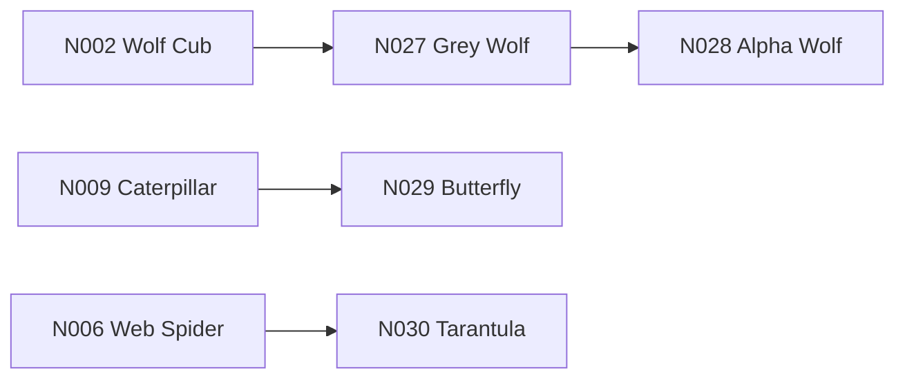
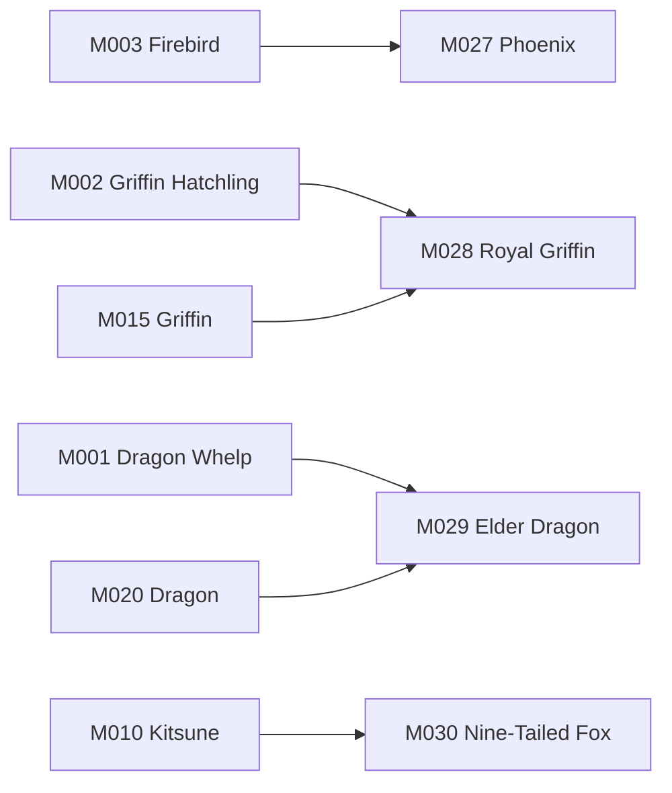
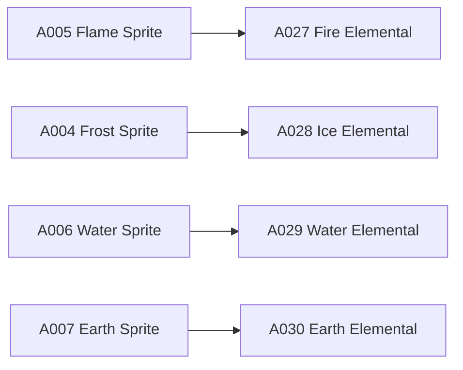
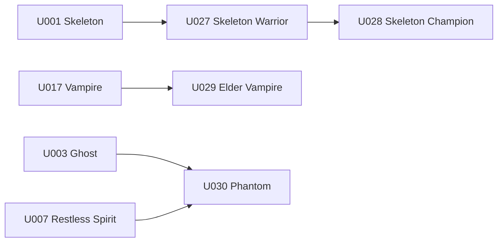
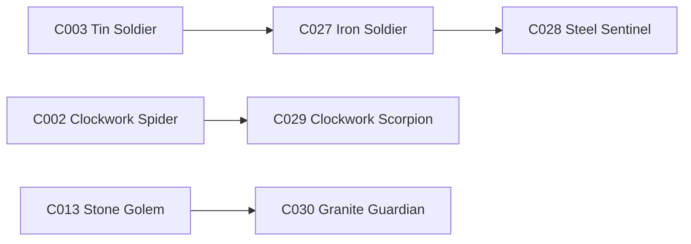

# Owner-designed evolution relationships

Each arrow is an allowed alternative predecessor. Inactive stages do not keep their passive effects.

## Nature

## Mythical

## Arcane

## Undead

## Constructs

